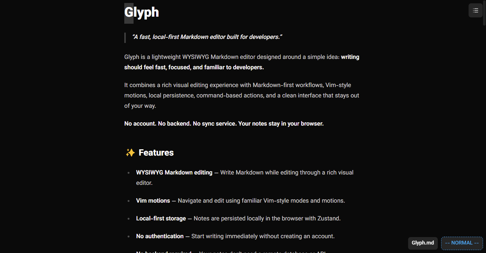
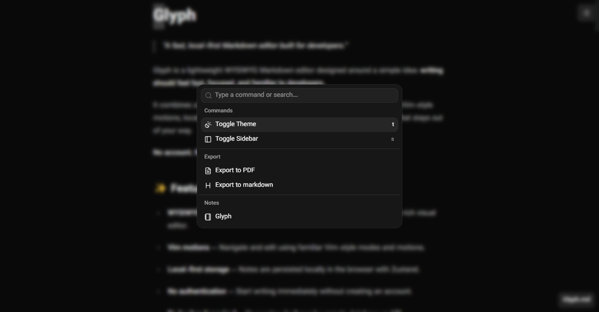
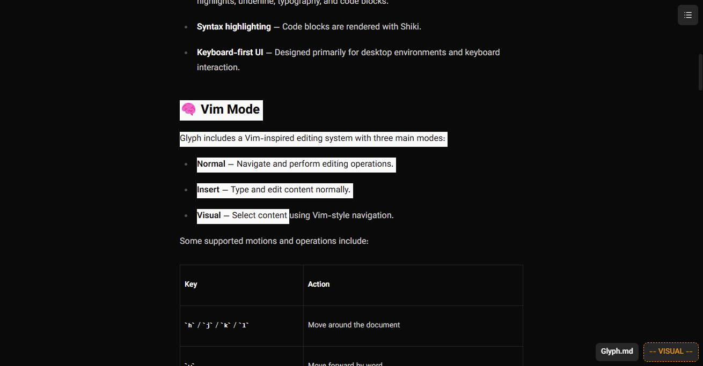

# Glyph

> **A keyboard-first Markdown editor for desktop, with synced notes and read-anywhere access.**

Glyph is a lightweight WYSIWYG Markdown editor built for developers who value speed, focus, and keyboard-driven workflows.

Write and edit on desktop with Vim-style motions, keep your notes synchronized through the cloud, and access them from your phone whenever you need them.

**Edit on desktop. Read on mobile. Stay in sync.**

[](https://glyph-sigma.vercel.app)

---

## ✨ Features

- **WYSIWYG Markdown editing** — Write Markdown through a rich visual editing experience.
- **Vim-style editing** — Navigate and edit documents using familiar Vim-inspired modes and motions.
- **Cloud synchronization** — Keep your notes synchronized across devices.
- **Progressive Web App (PWA)** — Install Glyph for an app-like experience on supported devices.
- **Desktop editing** — Access the full keyboard-driven editing experience on desktop and laptop environments.
- **Mobile reading** — Open and read your notes on mobile with a read-only experience.
- **Authentication** — Sign in to access your synchronized notes.
- **Multiple notes** — Create, rename, edit, and delete Markdown documents.
- **Command menu** — Access common actions without leaving the keyboard.
- **Markdown export** — Export notes as `.md` files.
- **PDF export** — Print documents and save them as PDFs.
- **Dark & light themes** — Choose the appearance that suits your workspace.
- **Rich Markdown** — Support for headings, lists, task lists, links, images, tables, highlights, underline, typography, and code blocks.
- **Syntax highlighting** — Render code blocks with Shiki.
- **Keyboard-first workflow** — Designed around efficient desktop editing and reduced dependence on the mouse.

---

## 📸 Screenshots

### Editor



### Command Menu



### Vim Mode



---

## 🌐 Live Demo

Try Glyph in your browser:

**[→ Open Glyph](https://glyph-sigma.vercel.app)**

Glyph is available on desktop and mobile. Sign in to access your synchronized notes.

Install Glyph as a PWA on supported devices for an app-like experience.

---

## 📱 Desktop & Mobile

Glyph provides different experiences depending on your device.

| Capability                |  Desktop  |  Mobile   |
| ------------------------- | :-------: | :-------: |
| View notes                |    Yes    |    Yes    |
| Create and edit notes     |    Yes    |    No     |
| Vim-style editing         |    Yes    |    No     |
| Keyboard-driven commands  |    Yes    |    No     |
| Access synchronized notes |    Yes    |    Yes    |
| Install as a PWA          | Supported | Supported |

### Desktop: Built for writing

The desktop experience is where Glyph's editing capabilities shine. Use Vim-style motions, navigate documents efficiently, manage notes, and write without constantly switching between your keyboard and mouse.

### Mobile: Your notes, wherever you go

The mobile experience focuses on reading. Access your synchronized notes from your phone without carrying your laptop, with editing intentionally reserved for desktop.

---

## ☁️ Cloud Synchronization

Glyph has evolved beyond its original local-only architecture.

Your notes can now be synchronized through the cloud, making them accessible across supported devices when you're signed in.

The synchronization layer builds on Appwrite for authentication and data storage.

### What this means

- Access your notes from desktop and mobile.
- Keep your documents available across devices.
- Use desktop for editing and mobile for reading.
- Install Glyph as a PWA instead of relying exclusively on a browser tab.

Cloud synchronization introduces a remote dependency that wasn't present in the original local-only version.

**Important:** Cloud synchronization requires network access to communicate with the remote service. Offline editing, conflict resolution, and automatic recovery of unsynchronized changes depend on the application's implementation and should not be assumed to work unless explicitly supported.

---

## 🧠 Vim Mode

Glyph includes a Vim-inspired editing system built around three modes:

| Mode       | Purpose                                   |
| ---------- | ----------------------------------------- |
| **Normal** | Navigate and perform editing operations   |
| **Insert** | Type and edit content normally            |
| **Visual** | Select content using Vim-style navigation |

### Supported motions & operations

| Key                   | Action                              |
| --------------------- | ----------------------------------- |
| `h` / `j` / `k` / `l` | Move around the document            |
| `w`                   | Move forward by word                |
| `b`                   | Move backward by word               |
| `e`                   | Move to the end of a word           |
| `0` / `^`             | Move to the beginning of a line     |
| `$`                   | Move to the end of a line           |
| `gg`                  | Go to the beginning of the document |
| `G`                   | Go to the end of the document       |
| `i`                   | Enter insert mode                   |
| `a`                   | Enter insert mode after the cursor  |
| `o` / `O`             | Create a line below / above         |
| `v`                   | Enter visual mode                   |
| `d` / `dd`            | Delete                              |
| `c` / `cc`            | Change                              |
| `y` / `yy`            | Yank                                |
| `x`                   | Delete a character                  |
| `r`                   | Replace a character                 |
| `Esc`                 | Return to normal mode               |

Glyph is **not intended to be a complete Vim implementation**.

Instead, it focuses on the navigation and editing operations that make Markdown writing faster and more enjoyable.

Vim-style editing is available in the desktop editing experience. Mobile is designed for viewing notes rather than editing them.

---

## ⌨️ Command Menu

Press `:` while in **Normal mode** to open the command menu.

Depending on the available commands, you can:

- Toggle the theme.
- Toggle the sidebar.
- Export the current note as Markdown.
- Export the current note as PDF.
- Switch between notes.

The command menu keeps frequently used actions accessible without interrupting a keyboard-driven workflow.

---

## 🏗️ Architecture

Glyph separates application routing, interface components, editor behavior, state management, and remote data access.

```text
┌─────────────────────────────────────────────┐
│                  Next.js                    │
│             Application / Routing           │
└──────────────────────┬──────────────────────┘
                       │
             ┌─────────┴─────────┐
             │                   │
             ▼                   ▼
      ┌──────────────┐    ┌──────────────┐
      │      UI      │    │    Editor    │
      │              │    │              │
      │ Sidebar      │    │    Tiptap    │
      │ Commands     │    │ Vim System   │
      │ Toolbar      │    │ Extensions   │
      └──────┬───────┘    └──────┬───────┘
             │                   │
             └─────────┬─────────┘
                       ▼
                ┌──────────────┐
                │    State     │
                │              │
                │   Zustand    │
                │ React Query  │
                └──────┬───────┘
                       │
                ┌──────┴───────┐
                │              │
                ▼              ▼
         ┌────────────┐  ┌────────────┐
         │   Local    │  │   Cloud    │
         │   State    │  │   Appwrite │
         │            │  │            │
         │ Persistence│  │ Auth / Data│
         └────────────┘  └────────────┘
```

### Main responsibilities

```text
app/
  Application routes and global styles

component/
  UI components and editor-facing components

hook/
  Reusable React hooks

lib/
  Editor behavior, Appwrite client, and utilities

store/
  Application state and note-related state

type/
  Shared TypeScript types
```

The architecture keeps editor interactions separate from remote data operations, helping the application support distinct desktop and mobile experiences.

---

## 💡 Key Technical Decisions

### Why Next.js?

Next.js provides application routing, the build pipeline, and a modern React environment for a multi-device application.

### Why Tiptap?

Glyph needs rich-text editing while preserving a Markdown-oriented workflow.

Tiptap provides a flexible ProseMirror-based foundation for custom extensions, structured documents, and editor behavior without requiring a rich-text engine to be built from scratch.

### Why Zustand?

Zustand provides lightweight state management for editor and interface state without the overhead of a larger state-management solution.

### Why TanStack Query?

Remote notes and authentication introduce asynchronous operations, loading states, errors, and cache management.

TanStack Query helps organize server-state fetching and mutations, making remote data interactions easier to manage.

### Why Appwrite?

Appwrite provides the backend services needed for authentication and cloud-stored notes, allowing Glyph to support signed-in users and cross-device access without building a custom backend from scratch.

### Why Vim-inspired editing?

Glyph targets users who spend much of their time at a keyboard.

Vim-style navigation reduces unnecessary mouse interaction and makes editing more efficient for users already familiar with modal editing.

### Why TypeScript?

The application combines editor state, note data, authentication, remote mutations, and device-specific interfaces.

TypeScript provides stronger contracts between these systems and helps make refactoring safer as the codebase evolves.

---

## 🧩 Challenges & Solutions

### 1. Implementing Vim-style editing in a rich-text editor

**Challenge**

Traditional Vim operates on text positions, while rich-text editors represent content as structured documents containing paragraphs, headings, lists, links, and other nodes.

**Solution**

Glyph implements Vim-inspired behavior on top of the editor's document and selection model, preserving the benefits of structured rich text while supporting familiar navigation.

### 2. Moving from local-only storage to cloud synchronization

**Challenge**

The original application stored notes locally, which limited access to the browser and device where the notes were created.

**Solution**

Glyph now integrates Appwrite for remote data storage and authentication, allowing signed-in users to access their notes across devices.

### 3. Supporting desktop editing and mobile reading

**Challenge**

Glyph's editing workflow relies on keyboard interaction and Vim motions, which are not well suited to a touch-first interface.

**Solution**

The application separates its experiences by device: desktop provides the editing workflow, while mobile focuses on accessing and reading notes.

### 4. Managing asynchronous remote state

**Challenge**

Cloud-backed notes require handling loading states, failed requests, authentication, and mutations.

**Solution**

TanStack Query provides a structured approach to remote data fetching and mutations, while authentication guards control access to protected application areas.

### 5. Keeping the interface focused

**Challenge**

An editor needs many actions, but constantly displaying every control makes the interface feel cluttered.

**Solution**

Glyph uses a command menu to keep secondary actions accessible on demand, preserving a minimal writing environment.

---

## 💾 Data & Persistence

Glyph combines local application state with remote storage to support its editing and synchronization workflows.

- **Local state:** Zustand manages application and editor-related state.
- **Remote data:** Appwrite stores notes for authenticated access.
- **Remote state management:** TanStack Query handles fetching and mutations.
- **Authentication:** Appwrite manages user authentication.

### Keep your notes safe

Cloud storage makes notes accessible across devices, but it should not be treated as a substitute for independent backups.

For important documents, export a Markdown copy and keep it somewhere safe.

Access to synchronized notes depends on the availability of the remote service, network connectivity, and valid authentication where required.

---

## 🛠️ Tech Stack

| Technology                    | Purpose                               |
| ----------------------------- | ------------------------------------- |
| **Next.js 16**                | Application framework                 |
| **React 19**                  | UI                                    |
| **TypeScript**                | Type-safe development                 |
| **Tiptap 3**                  | Rich-text editor                      |
| **Zustand**                   | Client-side state management          |
| **TanStack Query**            | Remote data fetching and mutations    |
| **Appwrite**                  | Authentication and cloud data storage |
| **Tailwind CSS 4**            | Styling                               |
| **shadcn/ui**                 | UI primitives                         |
| **Lucide**                    | Icons                                 |
| **Framer Motion**             | UI animations                         |
| **Shiki**                     | Syntax highlighting                   |
| **Sonner**                    | Notifications                         |
| **Progressive Web App (PWA)** | Installable app experience            |

---

## 🚀 Getting Started

### Prerequisites

- **Node.js 20+**
- **npm**, **pnpm**, **yarn**, or **Bun**
- An Appwrite project configured for the application

### Installation

Clone the repository:

```bash
git clone https://github.com/tasha-dev/glyph.git
cd glyph
```

Install dependencies:

```bash
npm install
```

### Environment variables

Configure the Appwrite environment variables required by the application:

```env
NEXT_PUBLIC_APPWRITE_PROJECT_ID=
NEXT_PUBLIC_APPWRITE_DB_ID=
NEXT_PUBLIC_APPWRITE_DB_TABLE_ID=
```

Use the corresponding values from your Appwrite project. Configure the required authentication providers, database table, permissions, and allowed origins in the Appwrite console.

Never put server secrets or private API keys in `NEXT_PUBLIC_` variables.

### Start the development server

```bash
npm run dev
```

Open:

```text
http://localhost:3000
```

### Production build

```bash
npm run build
npm run start
```

### Lint

```bash
npm run lint
```

---

## 🗂️ Project Structure

```text
app/             Next.js routes and global styles
component/       Editor, sidebar, toolbar, command menu, and UI
hook/            Reusable React hooks
lib/             Editor, Appwrite client, and utility logic
store/           Zustand stores and client-side state
type/            Shared TypeScript types
screenshots/     Project screenshots
```

---

## 🎯 Philosophy

Glyph started as a local-only Markdown editor built around a focused, keyboard-driven desktop workflow.

It has evolved to make those notes accessible beyond a single browser and device, without losing the editing experience that defines it.

The goal remains simple: make Markdown editing feel like using a dedicated writing application rather than filling out a web form.

**Fast editing. Minimal distractions. Synced notes. Access anywhere.**

Glyph is not trying to become a project-management platform or a collaborative document suite. It focuses on making personal Markdown writing and reading feel natural across devices.

---

## 📄 License

Glyph is open source and available under the [MIT License](LICENSE).

---

## 🌐 Links

**[Try Glyph →](https://glyph-sigma.vercel.app)**

**[GitHub Repository →](https://github.com/tasha-dev/glyph)**

---

Built with TypeScript, React, and a slightly unreasonable love for keyboard shortcuts.
